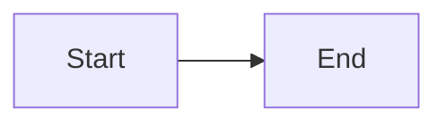

# pi-mermaid-preview

Preview Mermaid diagrams inside the [Pi coding agent](https://pi.dev/) terminal.

Run `/mermaid` to view a diagram from the last assistant reply.
Rendering is manual. The preview does not add messages to the model context.

## Preview

For this Mermaid source:



The terminal preview looks like this:

```text
┌───────┐     ┌─────┐
│ Start ├────►│ End │
└───────┘     └─────┘
```

The example above is simplified. Actual spacing depends on the renderer.
Output uses terminal characters, not browser images.

## Requirements

- Node.js 22.19 or later.
- Pi 1.4.0 or later.
- An interactive Pi terminal session.

## Install

Install the tagged version from GitHub:

```bash
pi install git:github.com/henrywen98/pi-mermaid-preview@v0.1.0
```

Run `/reload` in Pi, or restart Pi.

This package is not published to npm. The install command uses GitHub.

## Use

Ask Pi to include a fenced Mermaid code block in its reply.
Then run:

```text
/mermaid
```

Use `/mermaid 2` or `/mermaid 3` to select another diagram in that reply.

- Use the arrow keys to scroll.
- Use Page Up and Page Down to move vertically.
- Press Escape or `q` to close the preview.

Closing the preview returns to the conversation.
The preview is temporary and does not create a transcript entry.

Supported diagram families are flowcharts, sequences, classes, entity relationships, and states.
Support follows [beautiful-mermaid](https://github.com/lukilabs/beautiful-mermaid), not every feature in browser Mermaid.

This is a visual preview, not an official Mermaid syntax validator.
Some invalid syntax may be accepted or displayed differently.
RPC, JSON, and print modes do not display the preview.

## Limits and process controls

The extension checks input before starting a renderer:

| Item | Limit |
| --- | --- |
| Last assistant reply | 100,000 characters |
| Mermaid blocks per reply | 3 |
| Source per diagram | 8,000 characters and 160 lines |
| Renderer runtime | 3 seconds |
| Renderer stdout | 128 KiB |
| Output dimensions | 2,000 lines and 2,000 characters per line |

Extraction uses a bounded, line-based fence scanner.
Unclosed Mermaid blocks are rejected.

Rendering runs in a separate Node.js process.
The parent stops that process on timeout, cancellation, or excess output.
The child receives an empty environment and the diagram through standard input.
It does not receive inherited API keys, Node loader options, or shell arguments.

The child uses a 128 MiB V8 heap limit.
This is not a total process-memory limit or an operating-system sandbox.
The child still runs with your operating-system permissions.
A compromised dependency could access files or the network.

Input rejects terminal control and bidirectional formatting characters.
Output removes those characters before display.
Renderer failures return a generic message instead of raw parser errors.

Only one preview can run at a time.
Session shutdown cancels an active renderer.
The extension does not register an automatic rendering hook or a model tool.

See [SECURITY.md](SECURITY.md) for security reporting and review boundaries.

## Development

```bash
npm ci --ignore-scripts
npm run check
npm audit --omit=dev
```

Tests cover fence extraction, size limits, control characters, cancellation, timeout, child output, and the command adapter.
The UI test uses a mock terminal.
Check a real Pi terminal before relying on terminal-specific behavior.

Try the local extension:

```bash
pi --extension ./index.ts
```

For a personal local-path install:

```bash
pi install .
```

## Design and references

This is an independent implementation.
It uses [beautiful-mermaid](https://github.com/lukilabs/beautiful-mermaid) 1.1.3 to render diagrams.

The manual command and terminal-preview idea were informed by
[Gurpartap/pi-mermaid](https://github.com/Gurpartap/pi-mermaid).
The extension integration follows the
[Pi extension documentation](https://github.com/earendil-works/pi/blob/main/packages/coding-agent/docs/extensions.md).

This package does not copy the upstream extension implementation.
It does not depend on the official `mermaid` npm package.

See [THIRD_PARTY_NOTICES.md](THIRD_PARTY_NOTICES.md) for sources and licenses.

## License

[MIT](LICENSE), copyright Henry WEN.
Third-party packages keep their own licenses.
